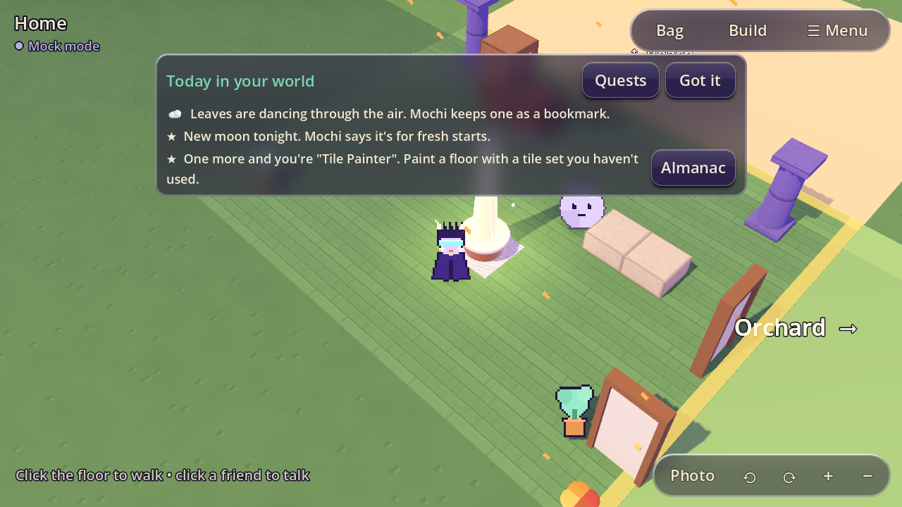

# Polox

> **Polox Public Beta 1.02** — A cozy, local-first 3D life-sim about **your** life.

Build rooms, draw the **Bramins** who live in your **Dream World**, and talk with them — they remember what you tell them and carry on with their own small lives while you're away. Map your real home and neighbourhood as the **Light World**, step through a glowing reddish bathtub-like **Dream Gate** into worlds you invent, and settle things in friendly battles you can design yourself.

Polox is built in **Godot 4.7.2** and written entirely in **GDScript**. It runs on Windows, Android, and in a phone's browser via Phone Link. Everything stays on your own devices: no accounts, no telemetry, no ads.

## Trailer

https://github.com/user-attachments/assets/c86a7720-7a5a-446d-bafb-977772e5cf2b

Download it in [1080p](https://github.com/SterburnDev/polox/releases/download/v1.0.0/Polox-Trailer-1080p.mp4) or [720p](https://github.com/SterburnDev/polox/releases/download/v1.0.0/Polox-Trailer-720p.mp4).
Song: Zachz Winner, Фрози, Joyful - Boogie. Music provided by NoCopyrightSounds ([ncs.io/boogie](https://ncs.io/boogie/67vx9bp)).
Character.AI is a trademark of its owner; Polox is not affiliated with or endorsed by Character.AI.



## New in Public Beta 1.02

- **Skip Light World creation & use a template anytime:** The Light World home creation sequence is **completely optional**. A prominent **SKIP & USE A TEMPLATE** banner right at the top lets you jump straight into a ready-made Light World home template (*Cozy Bedroom*, *Sunlit Studio*, *Cozy Apartment*, or *Garden Cottage*), or switch templates later in *Settings > Light World*.
- **Device-local by default:** Everything you make — worlds, friends, chats, memories, homes, drawings, settings, and keys — **stays on your device unless you choose to use a cloud service** (like Google Drive / OneDrive / Dropbox folder sync) or connect an online AI/map service yourself.
- **Mochi Soul & built-in 5-slot soundtrack:** **Mochi** now appears everywhere the Soul cursor is used (Title screen, Light World creation cursor, and Battles / Battle Maker), and all five music slots (*Light World creation*, *Title menu*, *Dream World*, *Battle*, and *Light World*) ship with their own distinct built-in tracks. *Polox Originals* remains one toggle away in *Title > Add-ons* if you want Polox's procedural tunes and the Dream Drop Soul.
- **Security touch-ups:** Bounded glTF/OBJ node graphs, buffers, and vertex/index counts in the custom 3D model loader; blocked executable/script file types and oversized entries inside `.polox` world bundles; strict HTTPS domain allow-listing on external Google Maps links; expanded API/token redaction in logs and repo scans; and pinned CI permissions/timeouts.

## New in Public Beta 1.01: Phone Link security

- **Pairing your phone gives nothing away on the Wi-Fi.** The PIN is sealed to a key your PC makes for the session, and the phone's key comes back encrypted. Then both screens show **three check words** to compare.
- **Your phone's key never travels again.** Every request is signed instead, works once and can't be changed. The PC signs its answers back, and the phone refuses anything that was changed on the way.
- **Web pages can't sneak in.** Phone Link refuses DNS-rebinding tricks and locks down its own pages with a strict Content-Security-Policy.
- Older apps keep working; pair them again to get all of this. Details, and what plain Wi-Fi still can't hide: [SECURITY.md](SECURITY.md).

## Highlights in Polox Public Beta 1.0

- **Dream World, Dream Gates & Bramins:** Explore your cozy **Dream World** inhabited by **Bramins**, step through the redesigned reddish glazed-ceramic bathtub-like **Dream Gate** (complete with brass clawfeet, faucet, touch ripples, and a tiny secret if you poke it enough), and keep full backward compatibility with earlier saves.
- **Custom 3D Models & Procedural PBR Textures:** Drop your own `.glb`, `.gltf`, or `.obj` 3D models right into rooms (`scripts/world/custom_models.gd`), decorate with new Frutiger Aero and retro props (lava lamp, arcade cabinet, Dream crystal, Aero water orb, retro CRT, suspicious yam), paint seamless custom tiles with quick pattern presets and seam-wrap preview, and enjoy procedurally generated normal maps on walls, floors, and blocks.
- **Google Maps Integration (Gemini / Google AI Plus):** Opt-in neighbourhood enrichment for players with Gemini, Google AI Plus / Google One AI, or Google Maps API keys — plus offline Google Maps URL coordinate parsing (`docs/GOOGLE_MAPS.md`).
- **Tactile Frutiger Aero + Liquid Glass Style & Human Charm:** Glossy horizon reflections, skeuomorphic stereo deck, multi-inspect furniture jokes, battle banter, title-screen secrets, and the scrollable HTML-tab `yams👀` secret vault in *Settings > Music*.
- **Local Soundtrack & Add-ons:** Drop in your own soundtrack for all five independent slots (*Title menu*, *Light World creation*, *Light World*, *Dream World*, *Battle*), custom Soul artwork (falling back to Polox's original **Dream Drop**), tiles, and word overrides (`docs/ADDONS.md`).

## Privacy

- **Personal information is optional.** Your name, pronouns, birthday, "about me", dreams, and real home can all be left blank or skipped, and changed or deleted any time.
- **Everything stays on your device.** Worlds, chats, drawings, custom models, settings, and API keys live in one folder on your PC or phone. There are no accounts, no Polox servers, and no telemetry.
- **Nothing leaves unless you connect it yourself:** cloud folder sync (Google Drive, OneDrive, Dropbox, Syncthing...), an online AI with your own key, OpenStreetMap or optional Google Maps enrichment when mapping your streets, or Phone Link between your own devices. Each is off until you turn it on.

Full details: [PRIVACY.md](PRIVACY.md) and [SECURITY.md](SECURITY.md).

## Play

| You have | Do this |
| --- | --- |
| A Windows PC | Run **`Polox-1.0.2-Setup.exe`** (Start menu entry, uninstaller, no admin needed), or unzip the **portable zip** anywhere and double-click `Polox.exe` |
| An Android phone | Install the APK, or open your PC's Phone Link address in the phone's browser |
| The source | `tools\get_godot.bat` once, then `run.bat` (Windows) or `./run.sh` (macOS, Linux) |

Browse the full documentation hub in [docs/INDEX.md](docs/INDEX.md) or jump straight into [docs/PLAYER_GUIDE.md](docs/PLAYER_GUIDE.md).

## Your worlds on your PC and your phone

| Way | When it works | What it needs |
| --- | --- | --- |
| **Phone Link** on the same Wi-Fi | Your PC is on and you are at home | Nothing but the PIN on the PC's screen |
| **Phone Link over Tailscale** | Your PC is on, you are anywhere | The free Tailscale app on both, same account |
| **Cloud folder sync** | Your PC is off | A folder your own cloud app keeps in step (Google Drive, OneDrive, Dropbox, Syncthing...) |

Local play never needs any of them. Setup and conflict-merging guide: [docs/SYNC.md](docs/SYNC.md).

## Build it yourself

Everything runs on Windows 10 or 11 (64-bit) from a plain clone. Every tool goes into `tools\` inside
the project and is verified by SHA-512 hash; nothing is installed system-wide. You need
[Git](https://git-scm.com/) and, for release builds, [Python 3.11 or newer](https://www.python.org/).

**1. Get the code and Godot 4.7.2** (about 86 MB, checked against its SHA-512):

```bat
git clone https://github.com/SterburnDev/polox.git
cd polox
tools\get_godot.bat
```

**2. Play and test from source.** No build needed:

```bat
run.bat                 rem play (your data goes to PersonalData\, which Git ignores)
check.bat               rem import, parse-check every script, privacy scan, full test suite, smoke run
check.bat test_secret   rem run a single test suite
```

**3. Optional: install your own local soundtrack, Soul picture, or secret vault pack** (stored in git-ignored `assets/local/`):

```bat
python tools\setup_local_pack.py --help
```

**4. Build custom engine templates & release downloads:**

See [docs/BUILDING.md](docs/BUILDING.md) for full Windows installer, web export, Android APK, and `tools/release/verify_pack.py` steps.

## Repository layout

| Path | What it holds |
| --- | --- |
| `.github/` | CI hygiene workflow, bug/feature issue templates, and PR checklist |
| `scripts/` | Game source grouped by feature: `core`, `ui`, `world`, `builder`, `characters`, `ai`, `home`, `battle`, `platform`, `phone`, `net`, `sync`, `items`, `variety` |
| `scenes/`, `shaders/`, `assets/` | Main scene, custom GLSL/Godot shaders, and cleared bundled textures, 3D furniture, materials, and sounds (`assets/local/` is git-ignored) |
| `bundled-addons/` | Built-in add-ons (`polox-originals`) — see [docs/ADDONS.md](docs/ADDONS.md) |
| `tests/` | Automated feature test suites (`test_<area>.gd`), fixtures, and Phone Link E2E checks |
| `tools/` | Engine downloaders, local pack helper (`setup_local_pack.py`), export scripts, release builders, artwork & Blender generators |
| `native/`, `addons/` | Custom engine patches and Android plugin |
| `docs/` | Complete player & developer documentation — start at [docs/INDEX.md](docs/INDEX.md) or [docs/DIRECTORY_GUIDE.md](docs/DIRECTORY_GUIDE.md) |

Your own data is never in the repository. From source it lives in `PersonalData/`, which Git ignores and no export includes.

## Public and private builds

The public repository builds a complete game using only cleared assets (Polox's synthesized tunes, the original **Dream Drop** Soul, and original SVG secret drawings). A local/private pack in git-ignored `assets/local/` can override the five soundtrack cues, Soul image, and built-in secret vault pictures without ever touching Git history. See [docs/RELEASES.md](docs/RELEASES.md) and [docs/ASSET_AUDIT.md](docs/ASSET_AUDIT.md).

## Contributing, licence, credits

- [CONTRIBUTING.md](CONTRIBUTING.md): setup, coding style, and PR expectations.
- [LICENSE](LICENSE): GNU General Public License, version 2 or later (`GPL-2.0-or-later`). Original art and sound made for Polox are under the same terms unless noted otherwise. Copyright (C) 2026 The Polox authors. See [docs/LICENSING.md](docs/LICENSING.md).
- [THIRD_PARTY_NOTICES.md](THIRD_PARTY_NOTICES.md): Godot, Kenney, Poly Haven, and third-party attributions.
- [CHANGELOG.md](CHANGELOG.md): full version history.

A gentle note: the friends in Polox are meant to be a cozy companion, not a replacement for the people in your life. If things feel heavy, please reach out to someone you trust or a local helpline (<https://findahelpline.com> lists free ones worldwide).
